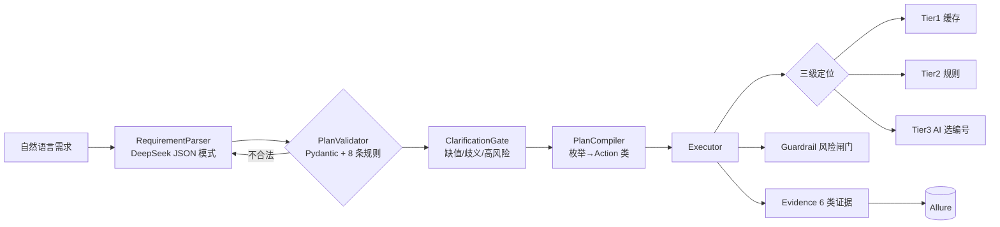

# AI 驱动的 UI 自动化测试框架


> 把「写 Selenium 脚本 → 调试 → 维护选择器」变成：
> **自然语言描述任务 → AI 澄清确认 → 自动执行 → 证据化报告**

一句话需求进，Allure 报告 + 6 类现场证据出。模型只在两处出现：生成计划、规则分不出高下时做「选择题」——
不写选择器、不执行代码、不决定风险。

```text
"登录后给 11111111 转 100 USD，断言余额减少"
        │
        ▼
  TestPlan (JSON, 可 review / 可 diff / 可版本化)
        │
        ▼
  闸门 → 三级定位 → 动作 → 6 类证据
```

---

## ✨ 核心特性

| 能力 | 说明 |
|---|---|
| **自然语言 → 计划** | 一句话生成可评审的 JSON 计划；Pydantic 校验结构，8 条业务规则校验「说得通」；不合法把报错原文回灌重问（≤2 次） |
| **三级定位** | 缓存优先（路由模板归一化 + 复用前 revalidate）→ 规则打分（`best ≥ 0.70` 且领先第二名 `≥ 0.15`）→ AI 兜底；同一量连续失败 3 次自动 `retired` |
| **防幻觉** | 模型只能在程序采集的候选里选编号，返回 `{candidate_id, confidence}`；编号越界或 `< 0.60` 直接拒绝，宁可失败也不瞎点 |
| **执行层护栏** | 风险由程序按「动作 + 中英词表 + 金额语义」判定，不采信模型自报；L3 动作需「计划签核 + 运行时放行」双开关，拦截状态是 `BLOCKED` 而非 `FAILED` |
| **6 类证据** | 需求 / 计划 / 定位链路 / 文本 diff / 元素 HTML / 截图，失败不用重跑，打开报告就能定位 |
| **可评审资产** | 计划是 JSON，进 Git、可 Code Review、算 `plan_hash`；改断言只改一个字段 |

## 🧠 怎么工作的



三个设计取舍：

1. **生成与执行分离** —— 计划可评审、可复现；回归期模型零调用。
2. **模型只做选择题** —— 选择器由程序生成，模型输出里没有 CSS/XPath/代码的位置。
3. **风险程序化** —— 支付/转账/删除/授权/发送/订单类动作统一 L3，双开关才放行。

## 🚀 快速开始

```bash
git clone <your-repo-url> aiui
cd aiui

python -m venv .venv
source .venv/bin/activate          # Windows: .venv\Scripts\activate
pip install -e ".[dev]"

cp .env.example .env               # 填入 AIUI_DEEPSEEK_API_KEY
```

浏览器驱动：把与本地 Chrome 匹配的 `chromedriver` 放到 `.drivers/chromedriver/<version>/`，
或设置 `AIUI_CHROMEDRIVER_PATH`；都没有时回退 Selenium Manager 自动下载。

### 三条命令跑通

```bash
# 0) 自检：驱动 / key / allure / 目录
aiui doctor

# 1) 生成计划（不执行）
aiui plan "登录后给 11111111 转 100 USD，断言余额减少" \
  --base-url http://localhost:8040 --sniff -o plans/transfer.json

# 2) 体检 + 签核高风险步骤
aiui lint plans/transfer.json
aiui approve plans/transfer.json s6 s7

# 3) 执行
aiui run plans/transfer.json --allow-high-risk all
aiui report
```

## 🧰 命令行

| 命令 | 作用 |
|---|---|
| `aiui plan "<需求>"` | 生成计划，不执行；`--sniff` 先采页面地图 |
| `aiui lint <plan>` | 静态体检：hints 质量 / 断言覆盖 / 签核状态，不启动浏览器 |
| `aiui approve <plan> [ids]` | 查看 / 签核高风险步骤 |
| `aiui run <plan>` | 执行计划；`--allow-high-risk all` 运行时放行 |
| `aiui go "<需求>"` | 生成 + 澄清 + 执行一条龙 |
| `aiui bench <plan> --rounds N` | 同一计划连跑 N 轮，看冷/暖缓存收敛 |
| `aiui suite "plans/*.json"` | 批量执行并汇总 |
| `aiui doctor` | 环境自检 |
| `aiui report` | 生成 Allure HTML |

## 📊 实测数据

框架自测：

| 指标 | 数值 |
|---|---|
| 用例数 | **98 passed** |
| 覆盖率 | 核心模块 **83.3%**（全量 75.4%） |
| 真实 Chrome E2E | 2 条（含「未签核被拦截」负向用例） |

Demo 页冷/暖缓存基准（`aiui bench --rounds 3`）：

```text
轮次  状态     步骤   cache  rule  ai  AI占比  平均定位  tokens  耗时
1     passed   5/5    0      3     0   0.0%    8.9ms    0      0.75s
2     passed   5/5    3      0     0   0.0%    11.7ms   0      0.57s
3     passed   5/5    3      0     0   0.0%    11.6ms   0      0.57s
```

> 真实项目上的数据见配套仓库 **virtual-bank-e2e**：5 条 E2E / 60 步，暖缓存 AI 调用 0 次。

## 📁 项目结构

```text
aiui/
├─ planning/   需求→计划（parser / validator 8 条规则 / clarify / compiler / lint）
├─ locator/    三级定位（collector / rules / cache / ai_matcher / resolver）
├─ actions/    10 类动作（静态注册表，无动态导入）
├─ executor/   runner 主循环 / context / browser
├─ guardrail/  风险分级与拦截
├─ evidence/   6 类证据 + 脱敏
├─ llm/        DeepSeek 网关 / Fake 回放 / 响应缓存 / 审计日志
└─ reporting/  Allure 适配（未安装时自动降级）
plans/         可评审的计划 JSON
tests/         98 条测试（模型/校验/定位/护栏/证据/E2E/计划回归）
docs/          设计文档、实现逻辑、验收记录、面试讲法
```

## 📚 文档

- [设计文档](docs/01-项目一-设计文档.md)：架构、数据契约、三级定位、护栏、里程碑
- [实现逻辑](docs/02-项目一-实现逻辑.md)：代码级说明 + 一次执行的时间线
- [验收记录](docs/03-验收记录-M1-M4.md)：98 条测试、覆盖率、真实链路数据
- [面试讲法](docs/07-简历口径与面试讲解.md)：简历五条 ↔ 代码 ↔ 高频追问

## ⚠️ 已知限制

- 仅 Web UI（不做 App / 小程序）；`iframe` 支持单层，`shadow DOM` 未支持；
- 计划生成依赖模型，离线场景可用 `--fake` 回放已生成计划；
- v1 不含 API / DB 动作类型（需要时再扩展，保持「10 类 UI 动作」的口径）。

## 📄 License

[MIT](LICENSE)
